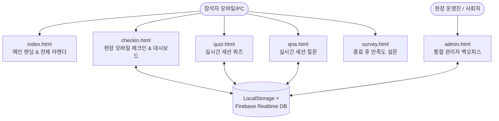

# 2026 HVAC Engineering Expert Seminar: 전체 프로젝트 구현 현황 보고서

**문서 번호**: `HVAC2026_implementation_status_report_261111_1217`  
**작성 일시**: 2026년 11월 11일 12:17 KST  
**프로젝트 공식 도메인**: [https://lghvac.app](https://lghvac.app)  
**레포지토리 브랜치**: `main` (배포 동기화 완료: `7d3fce8`)

---

## 1. 프로젝트 개요

| 항목 | 내용 |
| :--- | :--- |
| **행사명** | 2026 HVAC Engineering Expert Seminar (제10회 HVAC 전문가 세미나) |
| **슬로건** | AI & 친환경 시대, 차세대 공조 솔루션을 위한 HVAC Engineering Expert |
| **일시** | **2026년 11월 16일(월) 09:00 ~ 18:00** (입실 완료: 08:50) |
| **장소** | 국민대학교 본부관(별관) 1층 학술회의장 (만찬: 법학관 5층 천하 식당) |
| **주최 / 운영** | 주최: ES엔지니어링담당 · 운영: ES아카데미팀 |
| **핵심 목적** | 200여 명의 참가자가 모바일 하나로 출석, 아젠다 확인, 세션 질문, 실시간 퀴즈, 만족도 설문, 럭키드로우까지 매끄럽게 참여하는 올인원(All-in-One) 현장 웹 플랫폼 구축 |

---

## 2. 웹사이트 전체 아키텍처 및 페이지 구성도



---

## 3. 페이지별 구현 상세 현황

### 3.1 메인 랜딩 페이지 (`index.html`)
- **히어로 섹션 및 브랜딩**:
  - 골드 메달리온 & 럭셔리 다크 에메랄드 테마 디자인 적용
  - 행사 핵심 정보 (일시, 장소, 주최/운영진) 표기
  - 상단 퀵 네비게이션 및 하단 플로팅 체크인 바로가기 버튼 (`.checkin-float`)
- **키노트 & 6대 전문 세션 아젠다**:
  - Keynote 1, 2 및 Session 1~6에 대한 연사 프로필, 강연 주제, 타임테이블 표시
  - 세션별 핵심 요약 및 발표 자료 열람 연계
- **운영 안내 및 현장 동선**:
  - 불필요하고 중복된 7개 불릿 문구를 핵심 4개 항목(일시, 체크인, 점심/촬영, 일정안내)으로 압축하여 가독성 극대화
  - 국민대학교 정문 ➔ 본부관 학술회의장 ➔ 법학관 천하 식당 도보 동선 안내
- **카카오톡 및 SNS 공유 최적화 (OG Meta Tags)**:
  - 텍스트 가독성을 최우선으로 개선한 중앙 정렬 골드 타이포그래피 배너(`hvac-2026-title-banner-centered.jpg`) 적용
  - 카카오톡 채널 메시지용 2:1 비율 규격 배너(`800x400`, `1200x600`) 에셋 구축 완료

---

### 3.2 현장 모바일 체크인 & 개인화 대시보드 (`checkin.html`)
- **사전 기간(11/11 ~ 11/15) 정중한 안내 팝업 모달 (`#modalPreEventNotice`)**:
  - `[현장 모바일 체크인 시작]` 클릭 시 행사 당일 현장 공개 안내 팝업 자동 표출
  - 체크인 기능은 열어두어 `[확인 및 계속 진행 ➔]`을 통해 사전 둘러보기/테스트 지원
  - `[📅 행사 시간표 보기]` 및 `[닫기]` 지원
- **행사 당일(11/16 00:00 KST 이후) 자동 직행 로직**:
  - 11/16 당일부터는 팝업이 자동으로 뜨지 않으며, 버튼 클릭 즉시 1단계로 직행
  - 운영진 테스트를 위한 파라미터 지원 (`?pre_event=1`, `?pre_event=0`, `?test_date=YYYY-MM-DD`)
- **비밀번호 표출 장소 안내 일원화**:
  - 인트로 카드, 2단계 비밀번호 입력창(`inputPin`), 안내 카드, 불일치 오류 메시지(`pinErrorMsg`), 확인 모달에 걸쳐 **"행사장 1층 로비 운영데스크 또는 학술회의장 메인 스크린 화면"**으로 표기 통일
- **사전 등록 명부 자동 완성 & 1인 1기기 세션 보안**:
  - 사번/이메일 입력 시 사전 등록자 명부(200여 명)와 대조하여 성명/부서/직급 자동 매칭
  - 동일 계정의 다중 기기 중복 접속 실시간 감지 및 이전 세션 강제 종료(`modalSessionTerminated`)
- **N번째 체크인 깜짝 당첨 축하 팝업 (`modalMilestonePrize`)**:
  - 운영진이 지정한 특정 순번(예: 10번째, 50번째 등) 체크인 시 팡파레 효과와 함께 풀스크린 축하 모달 발동
- **체크인 완료 대시보드 (`#screenDash`)**:
  - 실시간 현재 진행 세션 하이라이트
  - 타임테이블 시트 열람, 행사장 약도 모달, 세션별 실시간 질문 작성 시트 연동

---

### 3.3 실시간 퀴즈 시스템 (`quiz.html`)
- **세션별 퀴즈 문항 및 보기 구성**:
  - 각 세션 종료 직후 강연 내용 기반 4지선다형 퀴즈 제공
  - 관리자 백오피스의 퀴즈 오픈/마감 원격 제어 상태와 실시간 동기화
- **세션 선택 드롭다운 개선**:
  - 진행 중인 세션 또는 이전 세션을 손쉽게 전환하여 응시할 수 있는 상단 세션 선택 UI
- **자동 채점 및 해설 제공**:
  - 제출 즉시 정답 여부 및 상세 해설 제공, 응시 결과는 로컬 및 클라우드 동시 집계
- **럭키드로우 추첨권 연계**:
  - 정답자에게 클로징 럭키드로우 추가 응모권 자동 부여

---

### 3.4 실시간 Q&A 시스템 (`qna.html`)
- **참석자 실시간 질문 등록**:
  - 익명 / 실명 선택 가능, 질문 내용 입력 시 세션 태그 자동 부여
- **참석자 공감 추천 (Upvote)**:
  - 다른 참가자의 좋은 질문에 '공감' 투표하여 상위 질문으로 자동 랭킹화
- **관리자/사회자 채택 표시**:
  - 관리자 페이지에서 질문 채택 시 "현장 답변 채택" 뱃지가 실시간 부착되어 스크린 표출 연계

---

### 3.5 만족도 설문조사 (`survey.html`)
- **세미나 종합 평가 설문**:
  - 세미나 전반 만족도, 발표 세션별 유익성, 운영/시설/만찬 평가 5점 척도 설문
  - 주관식 건의사항 및 피드백 수렴
- **중복 제출 방지**:
  - 체크인된 참석자 계정당 1회 제출 제한 및 제출 완료 뱃지 처리

---

### 3.6 통합 관리자 백오피스 (`admin.html`)
- **현장 실시간 출석 모니터링**:
  - 총 등록자 수, 현재 체크인 완료자 수, 출석률 프로그레스 바 실시간 갱신
  - 출석자 명부 엑셀(CSV) 다운로드 기능
- **현장 체크인 인증 비밀번호(PIN) 관리**:
  - `hvac_checkin_passcode` (기본값: `0000`) 실시간 변경 및 클라우드 즉시 푸시
- **실시간 퀴즈 출제 & 원격 잠금/해제 제어**:
  - 세션별 퀴즈 문제 등록/수정, 퀴즈 오픈/종료 토글 버튼
- **실시간 카카오톡 공지문 자동 생성기**:
  - 세션 종료 시 "세션 N 퀴즈 참여 안내" 문구를 원클릭으로 클립보드 복사하여 단톡방 공유 지원
- **럭키드로우(경품 추첨) 시스템**:
  - 체크인 참석자 명단 및 퀴즈 정답자 가중치를 반영한 인터랙티브 디지털 추첨기
- **사회자(MC) 전용 뷰 분리 아키텍처 수립 완료**:
  - 복잡한 관리 설정 없이 타임테이블, 현재 세션 질문 랭킹, 추첨기만 깔끔하게 볼 수 있는 분리 설계안 수립

---

## 4. 최근 주요 이슈 개선 및 보완 내역

```
[2026-11-10 ~ 11-11 주요 개선 사항]
1. 카카오톡 채널 메시지 배너 에셋 규격(2:1, 1200x600 / 800x400) 추가 제작 및 배포
2. 카카오톡 링크 미리보기(OG) 배너: 원형 메달리온 제거 및 골드 타이포그래피 중앙 정렬 배너로 가독성 전면 개선
3. 퀴즈 플로팅 알림 배너: 최초 노출 15초 유지 후 자동 닫힘 및 1분 후 재방문 시 자동 억제(피로도 최소화)
4. 본문 안내 문구 다이어트: index.html 및 admin.html 내 중복 불릿 7개 -> 4개로 슬림화
5. 사전 체크인 현장 비밀번호 안내 팝업 모달 신설 (11/15까지 표출, 11/16 당일 자동 직행)
6. 비밀번호 표출 장소 문구("1층 로비 운영데스크 및 학술회의장 화면") 전 사이트 일원화
```

---

## 5. 프로젝트 파일 구조도

```
10th-HVAC/
├── assets/
│   ├── hvac-core.js                    # 실시간 Firebase/LocalStorage 공통 라이브러리
│   ├── hvac-2026-title-banner-centered.jpg # 카톡 OG 링크 미리보기용 최적화 배너
│   ├── kakao-channel-banner-1200x600.jpg   # 카카오톡 채널 가로형 메시지 권장 배너
│   ├── kakao-channel-banner-800x400.jpg    # 카카오톡 채널 기본 배너
│   ├── milestone-celebration.jpg       # N번째 체크인 당첨 축하 이미지
│   └── (기타 디자인 및 강연자 프로필 에셋)
├── index.html                          # 세미나 공식 랜딩 및 전체 아젠다
├── checkin.html                        # 현장 모바일 체크인 & 대시보드
├── quiz.html                           # 실시간 세션 퀴즈
├── qna.html                            # 실시간 세션 Q&A
├── survey.html                         # 세미나 만족도 설문
├── admin.html                          # 통합 관리자 백오피스
├── CNAME                               # lghvac.app 커스텀 도메인
└── site-config.json                    # 사이트 기본 정적 메타데이터
```

---

## 6. 결론 및 향후 운영 제언

현재 시스템은 **2026년 11월 16일(월) 세미나 당일 200여 명의 참가자가 안정적으로 접속하고 활용할 수 있는 모든 필수 기능과 예외 처리(사전 팝업 분기, 1인 1기기 세션 보안, 실시간 클라우드 동기화, 모바일 반응형)**가 완벽히 구축되어 배포되었습니다.

향후 현장 리허설 시 다음 2가지를 점검하시면 더욱 원활한 운영이 가능합니다:
1. **행사장 로비 운영데스크 및 학술회의장 스크린에 표출할 4자리 비밀번호 확인** (기본값 `0000` 사용 또는 관리자 페이지에서 변경)
2. **사회자용 스크린 또는 태블릿 환경 테스트** (Q&A 질문 상위 랭킹 확인 및 럭키드로우 추첨 화면 확인)
